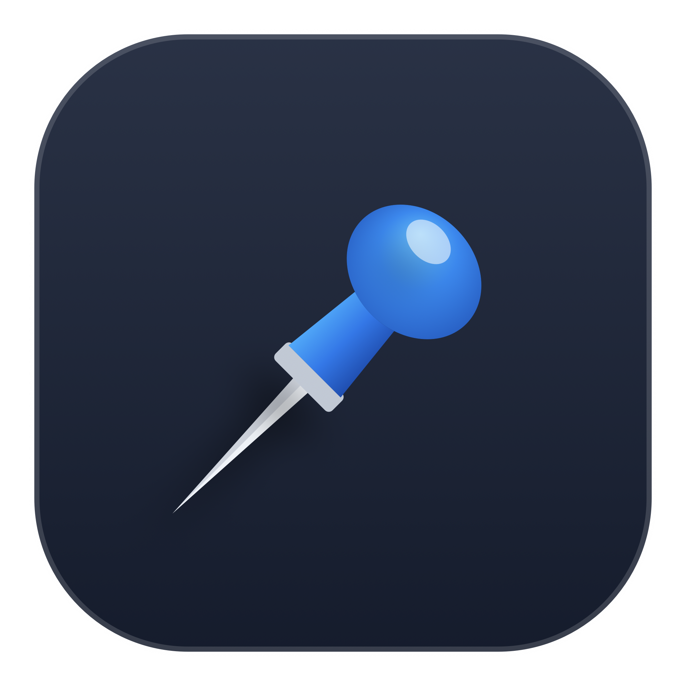

<p align="center">
  
</p>

<h1 align="center">BlueClip</h1>

<p align="center">
  <strong>Native macOS Menu Bar Clipboard Manager with Private Cloud Synchronization & Multi-Mac Unification</strong>
</p>

<p align="center">
  <a href="https://github.com/joehagerman/BlueClip/releases/latest/download/BlueClip-v2.0.0-macOS.zip">
    
  </a>
</p>

<p align="center">
  
  
  
  
  
</p>

---

## Overview

**BlueClip** is a high-performance, native macOS menu bar application (`LSUIElement`) designed as a modern, privacy-first successor to classic clipboard managers like CopyClip. Built with Apple Swift 6 and SwiftUI, BlueClip seamlessly tracks your copy history, categorizes clippings using Apple Foundation Model (AFM) intelligence, and synchronizes your unified clipboard across multiple Macs via an end-to-end private network synchronization hub.

Running quietly in your macOS status bar, BlueClip combines ultra-low memory overhead with instant keyboard hotkeys (`⌘0`–`⌘9`), high-precision auto-paste simulation, security blacklists, and a companion Web Viewer dashboard with multi-layer offline local caching.

---

## Direct Download

| Format | Target Platform | Release Package |
|:---|:---|:---|
| **ZIP Archive (.zip)** *(Recommended)* | macOS 13.0 or later (Apple Silicon arm64) | [**Download BlueClip-v2.0.0-macOS.zip**](https://github.com/joehagerman/BlueClip/releases/latest/download/BlueClip-v2.0.0-macOS.zip) |

All official release builds, signatures, and changelogs are available on the [GitHub Releases Page](https://github.com/joehagerman/BlueClip/releases).

---

## 🔍 Feature Comparison: CopyClip vs. BlueClip

| Feature Category | Original CopyClip (v1.9.87) | Modern BlueClip (v2.0.0) |
| :--- | :--- | :--- |
| **Menu Bar Icon** | Monochrome black squircle | **Signature Vibrant Blue Pin** (or adaptive white template) |
| **Sorting Engine** | Chronological list only | **Dual Mode**: Chronological & **Group by Keywords (AFM)** |
| **Display Limits** | Fixed display limit | **Configurable Subsettings**: 5, 10, 15, 25, 50, or All clips |
| **Tag Ordering** | ❌ None | 🏷️ **Most Frequent, Hottest (Recent), or All (A–Z)** |
| **History Navigation** | Numbered hotkeys 1–9, plain text list | **Numbered ⌘0–⌘9 hotkeys**, app source badges, timestamps, search filter |
| **Auto-Paste Simulation** | Basic paste simulation | **High-precision CGEvent ⌘V injection** with instant focus restoration |
| **Audio Feedback** | System click sound | **Native macOS audio feedback** (`Tink` on capture, `Pop` on select) |
| **Privacy Blacklist** | Exclude selected apps from recording | **Preconfigured security blacklist** (1Password, Bitwarden, Keychain, Passwords) + custom app picker |
| **Clips Management** | Basic list view | **Split-view Inspector**: raw monospace viewer, word/character/line counts, export to JSON/CSV/TXT |
| **Pinning Support** | ❌ Not supported | 📌 **Pin essential clips** to preserve them permanently at top |
| **Cloud Synchronization** | ❌ None (Local only) | 🌐 **Private Network Sync** (custom cloud server or local hub) |
| **Pairing Model** | ❌ None | 🔐 **Colloquial Sharewords** (e.g. `77 amber tigers`) with SHA-256 tokens |
| **Cross-Device Web Viewer** | ❌ None | 📱 **Responsive Web History Dashboard** (`web_viewer.html`) with tag grouping |
| **Offline Cache** | Single file | 📦 **Triple-Store Redundancy** & browser `localStorage` instant cache |

---

## Key Capabilities

### 1. Dual Mode Sorting & AFM Tag Explorer
- **Chronological Mode**: View your most recent clippings with quick selectors (`5, 10, 15, 25, 50, All`).
- **Group by Keywords (AFM)**: Automatically sends copied text to Apple Foundation Models to extract top keywords and clusters clippings into interactive accordion groups.
- **Tag Subsettings**: Order tag clusters by **Most Frequent (📊)**, **Hottest / Recent (🔥)**, or **Alphabetical (🔤)**, with display caps (`Top 5, 10, 15, 25, All Tags`).

### 2. Multi-Mac Unification with Colloquial Sharewords
- Effortlessly pair multiple Macs without configuring complicated VPNs or databases.
- Enter your **Email** and a fun, colloquial **Shareword** (e.g. `77 amber tigers` — singular or plural both match).
- All Macs automatically unify, deduplicate by text, preserve pinned states, and merge clipboard history.
- Shareword tokens are protected using SHA-256 cryptographic hashing (`?account=...&hash=...`) to prevent token leakage in server logs.

### 3. "All History" Suite & Instant Hotkeys
- **`⌘0`–`⌘9` Quick Paste**: Instantly select and inject clippings directly into the frontmost app without touching the mouse.
- **Copy All**: Formats and concatenates all clips with dividers into the clipboard in one click.
- **Export All**: Export full history into structured JSON or formatted text (`.txt`).
- **Delete All**: Cleanly purge history with a native confirmation safety sheet.

### 4. Interactive Web Companion with Local Offline Caching
- Access your clipboard history from any web browser or mobile device via `server/web_viewer.html`.
- **Instant Local Cache**: Browser `localStorage` hydrates clippings in 0ms — no blank screens or loading spinners.
- **Offline Indicator**: Automatically detects connectivity drops (`📦 Local Cache (Offline)`) and lets you search, copy, pin, and export offline.
- **Full Parity**: Supports live search, pin/unpin, delete, quick paste, and tag sorting directly in the web UI.

---

## 🏛️ Application Architecture

```text
BlueClip/
├── Package.swift                    # Swift Package Manager manifest (Swift 6)
├── run.sh                           # Build, clean & packaging script (.app bundle)
├── Resources/
│   ├── AppIcon.icns                 # High-resolution macOS application icon bundle
│   ├── AppIcon.png                  # 1024x1024 master icon
│   ├── MenuBarIconBlue.png          # Signature vibrant blue pushpin asset
│   ├── MenuBarIcon.png              # Adaptive monochrome menu bar asset
│   ├── generate_icons.swift         # Vector icon generation pipeline
│   └── generate_pushpin_icons.swift # High-resolution pushpin generator
├── Sources/
│   ├── BlueClipApp.swift            # StatusItem, popover manager & app lifecycle
│   ├── BlueClipApp+Menu.swift       # Dynamic native menu bar builder
│   ├── BlueClipApp+Actions.swift    # Menu bar actions & export handlers
│   ├── Models/
│   │   ├── ClipItem.swift           # Codable clip model with timeAgo & preview
│   │   ├── AppPreferences.swift     # Persistent settings, SHA-256 tokens & blacklist
│   │   └── SyncStatus.swift         # Network sync payload & status models
│   ├── Services/
│   │   ├── ClipboardMonitorService.swift # NSPasteboard polling & deduplication
│   │   ├── StorageService.swift     # Triple-store local persistence & fallback cache
│   │   ├── NetworkSyncService.swift # REST sync engine with SHA-256 token hashing
│   │   ├── AFMKeywordService.swift  # Apple Foundation Model keyword extraction
│   │   ├── AutoPasteService.swift   # CGEvent virtual keycode injection
│   │   └── CopyClipImporterService.swift # One-click migration from legacy CopyClip
│   └── Views/
│       ├── MenuBarPopupView.swift   # Dropdown popover with search & quick copy
│       ├── PreferencesView.swift    # 5-tab macOS settings window
│       ├── Components/              # Custom squircle icons & clip row views
│       └── Tabs/
│           ├── GeneralTabView.swift          # Max clips, snippet limits, sounds
│           ├── IgnoredAppsTabView.swift      # Password manager blacklist
│           ├── ClipsManagementTabView.swift  # Split-view inspector & export
│           ├── SyncTabView.swift             # Cloud server & shareword pairing
│           └── AboutTabView.swift            # Branded About view with Easter Egg
└── server/
    ├── clipboard_server.py          # Zero-dependency Python standard library server
    ├── web_viewer.html              # Responsive web viewer with AFM tag grouping
    ├── README_SERVER.md             # Cloud deployment guide
    └── clipboard_history.sample.json # Sample schema payload
```

---

## 🚀 Quick Start

### 1. Building & Launching
Clone the repository and run the automated build script:

```bash
git clone https://github.com/joehagerman/BlueClip.git
cd BlueClip
./run.sh
```

BlueClip compiles via Swift Package Manager, applies `dot_clean`, creates `build/BlueClip.app`, starts the background local sync hub on port `8008`, and places the **Blue Pin** icon in your macOS menu bar.

### 2. Basic Operations
- **Copy**: Copy text anywhere on your Mac (`⌘C`). BlueClip records the content, app source, and timestamp.
- **Paste from History**: Click the menu bar icon and press **⌘0–⌘9** or click any clip to automatically paste (`⌘V`) into your active document.
- **Search**: Click the menu bar icon and type in the search bar to filter clips by text, app name, or keywords.
- **Pin**: Click the pin icon next to any clip to permanently preserve it at the top of your list.

### 3. Preferences & Security Blacklist
- Open **Preferences…** (`⌘,`).
- **Ignored Apps**: 1Password, Bitwarden, Apple Passwords, and Keychain Access are blacklisted by default. Add any custom application with one click.
- **Sync**: Enter your Email and Shareword to merge clipboard history across all your Macs.

---

## 🌐 Private Self-Hosting Guide

BlueClip is completely zero-dependency and can be hosted on any private cloud server, VPS, or Raspberry Pi.

```bash
# On your server:
cd /var/www/blueclip
python3 clipboard_server.py 8008
```

Open BlueClip Preferences ➔ **Sync**, set your server URL (`https://your-server.com`), and your clipboard will automatically unify in real time.

---

## 📄 License

This project is licensed under the [MIT License](LICENSE).
